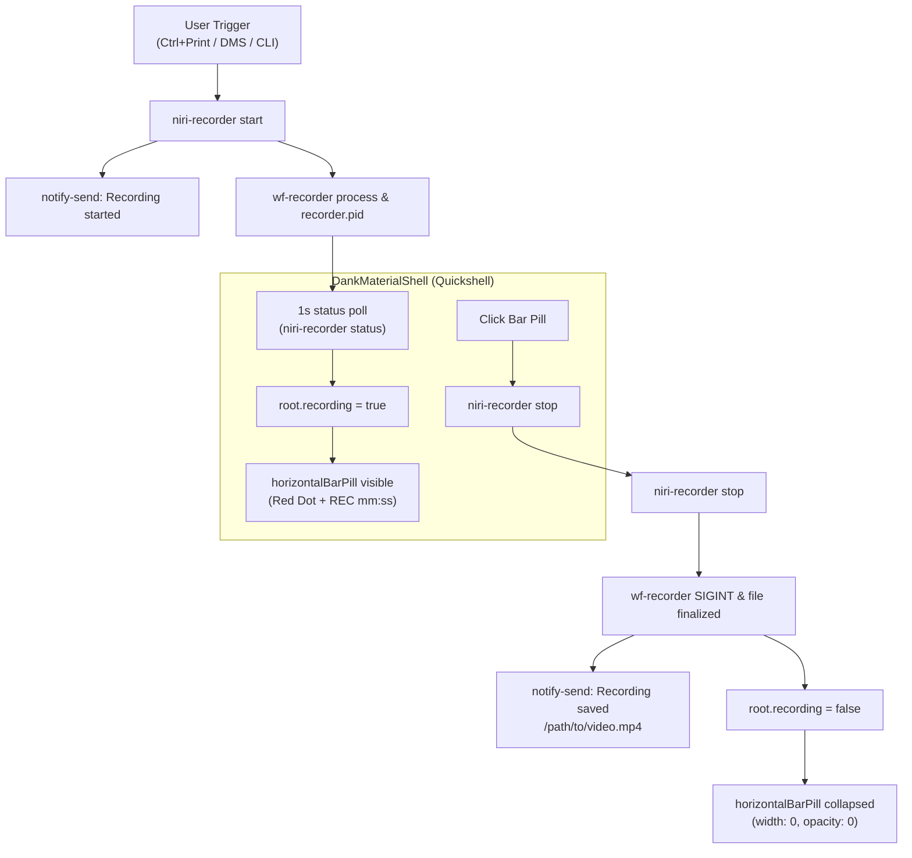

# DankMaterialShell Top Bar Recording Indicator & Desktop Notifications Design

**Date:** 2026-10-27  
**Status:** Approved  
**Target:** DankMaterialShell (DMS) ≥ 1.5, Quickshell, Niri Wayland Compositor, `niri-recorder`

## 1. Overview

Provide a seamless visual indicator and notification experience when recording the screen:
- **DankMaterialShell top bar:** An indicator icon with a live elapsed recording timer (`REC mm:ss`) appears automatically on the top bar when recording starts, and collapses completely (disappears) when recording stops.
- **Click to stop:** Clicking the indicator pill on the top bar sends the stop signal to finalize the recording.
- **Desktop notifications:** System notifications via `notify-send` inform the user when recording starts, when the finalized file is saved, and when capture fails.

## 2. Architecture & Components

### 2.1 DMS Plugin (`data/dms-plugin/niriRecorder/NiriRecorder.qml`)

1. **Visibility Control:**
   - Set `_visibilityOverride: true`.
   - Set `_visibilityOverrideValue: root.recording || root.pending`.
   - When idle (`root.recording` and `root.pending` are `false`), `effectiveVisible` evaluates to `false`. DMS's `BasePill` triggers its built-in `"hidden"` state transition, animating `width: 0` and `opacity: 0`. The widget occupies no visual space on the top bar.
   - When active (`recording` or `pending`), `effectiveVisible` is `true`, animating the pill into the top bar layout.

2. **Visual Content & Timer:**
   - **Horizontal Bar Pill:**
     - Left icon: `DankIcon` with `radio_button_checked` in `Theme.error` (red). If in `pending` state, display `hourglass_top` in `Theme.primary`.
     - Right label: `StyledText` displaying `REC mm:ss` (or `hh:mm:ss` for recordings exceeding 1 hour).
   - **Vertical Bar Pill:**
     - `DankIcon` with matching status icon and color.
   - **Timer Lifecycle:**
     - A 1-second `Timer` updates `elapsedSeconds` from `(Date.now() - recordingStartTime) / 1000`.
     - When `root.recording` transitions to `true`, `recordingStartTime` initializes to `Date.now()`.
     - When `root.recording` transitions to `false`, `elapsedSeconds` resets to `0` and `recordingStartTime` resets to `null`.

3. **Status Polling & Control:**
   - Poll interval: 1000 ms (reduced from 2000 ms for faster UI pickup of external hotkeys like `Ctrl+Print`).
   - `pillClickAction`: invokes `root.toggle()`, which triggers `niri-recorder stop` when recording.
   - Control Center tile remains available as a secondary start/stop toggle.

### 2.2 Core Notifications (`src/app/notify.rs` & CLI / Daemon)

1. **Trigger Points:**
   - **Start:** `notify-send --app-name niri-recorder --icon media-record --hint string:desktop-entry:io.github.niri_recorder "Recording started" "Capturing <target>"`
   - **Save:** `notify-send --app-name niri-recorder --icon media-record --hint string:desktop-entry:io.github.niri_recorder "Recording saved" "<output-path>"`
   - **Error / Interruption:** `notify-send --app-name niri-recorder --icon media-record --hint string:desktop-entry:io.github.niri_recorder "Recording failed" "<error>"`
2. **Binary Installation:**
   - Build and install the latest binary to `~/.cargo/bin/niri-recorder` so keybindings in `~/.config/niri/config.kdl` execute the updated code with notification support.

### 2.3 DMS Bar Configuration & Deployment

1. **Plugin Installation:**
   - Copy `data/dms-plugin/niriRecorder/` to `~/.config/DankMaterialShell/plugins/niriRecorder/`.
2. **DMS Settings Integration:**
   - Update `~/.config/DankMaterialShell/settings.json` under `barConfigs` `leftWidgets`:
     - Replace `wlScreenrecWrapper` with `niriRecorder` (enabled: true).
   - Ensure `niriRecorder: { "enabled": true }` in `~/.config/DankMaterialShell/plugin_settings.json`.
3. **Live Reload:**
   - Execute `dms ipc call plugins reload niriRecorder` (or restart DMS if needed) to activate the plugin immediately in the running shell session.

## 3. Error Handling & Edge Cases

- **Region Selection Cancelled:** If the user presses `Escape` during `slurp` region selection, `niri-recorder` exits cleanly with code 0 without firing a failure notification. The top bar widget briefly displays `hourglass_top` and cleanly returns to hidden.
- **Zombie / Backend Crash:** If `wf-recorder` exits unexpectedly, `niri-recorder` detects process death, notifies `"Recording ended early"`, and cleans up the pidfile. The top bar widget returns to hidden on the next poll cycle (within 1s).
- **Missing `notify-send`:** Notification calls are non-blocking and ignore process spawn errors, ensuring recording and bar indicator behavior are never broken if notifications are unavailable.

## 4. Verification & Validation

1. **Code & Test Checks:**
   - Run `make check` (formatting, clippy `-D warnings`, unit tests, package build).
2. **Functional Top Bar Verification:**
   - With DMS running and plugin loaded, verify that no recording icon is visible on the top bar while idle.
   - Press `Ctrl+Print` and select a region (or run `niri-recorder start --target region`).
   - Confirm desktop notification: `"Recording started: Capturing region"`.
   - Confirm red recording icon and live `REC 00:xx` timer appear on the DMS top bar.
   - Click the top bar pill (or press `Ctrl+Shift+Print`).
   - Confirm top bar pill collapses and disappears immediately.
   - Confirm desktop notification: `"Recording saved: /home/exodia/Videos/rec_...mp4"`.
